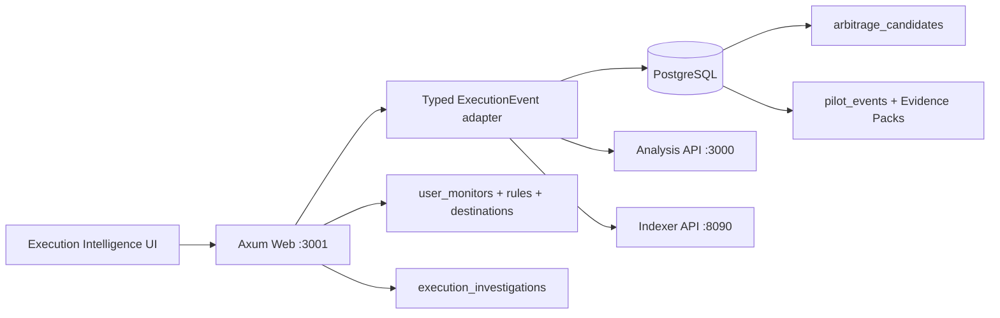
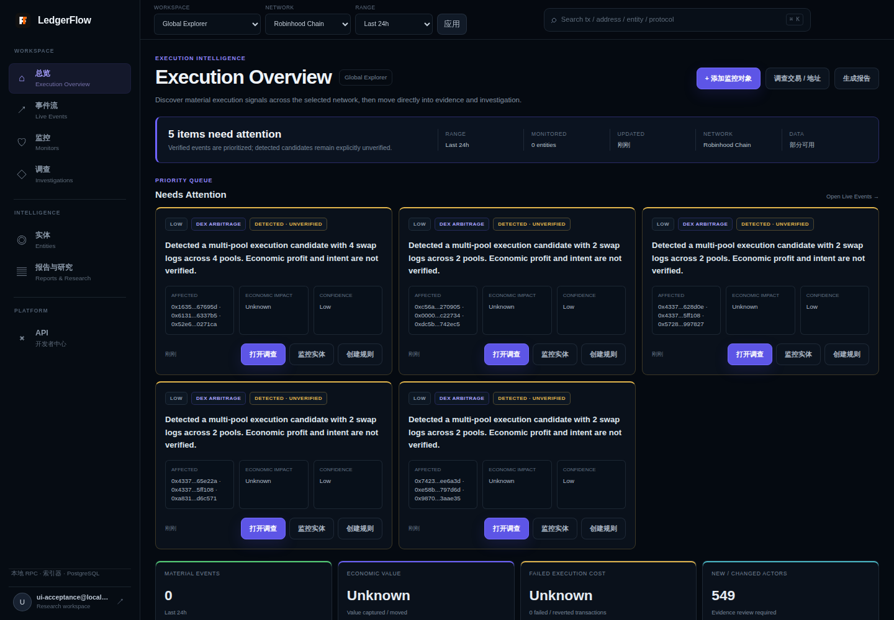
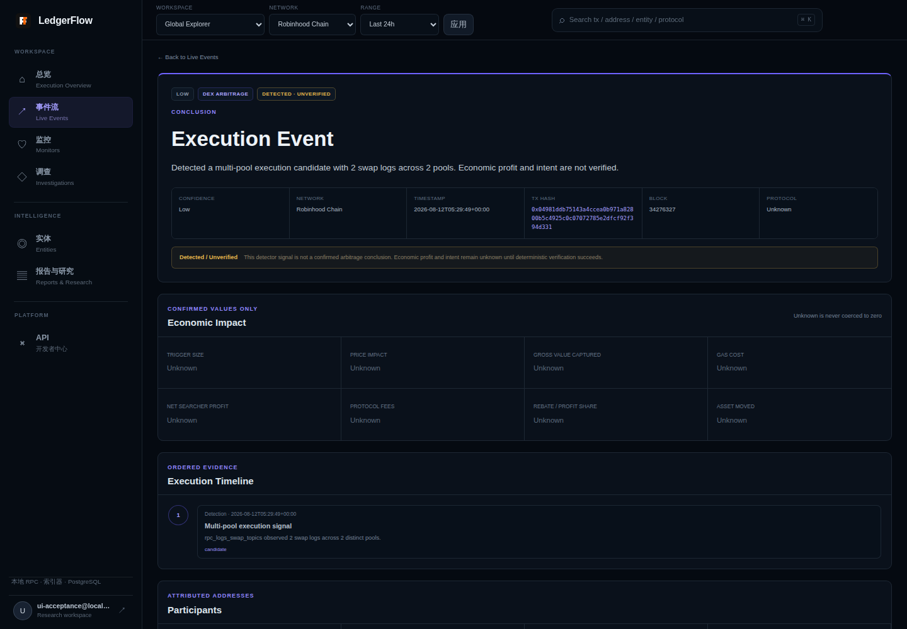
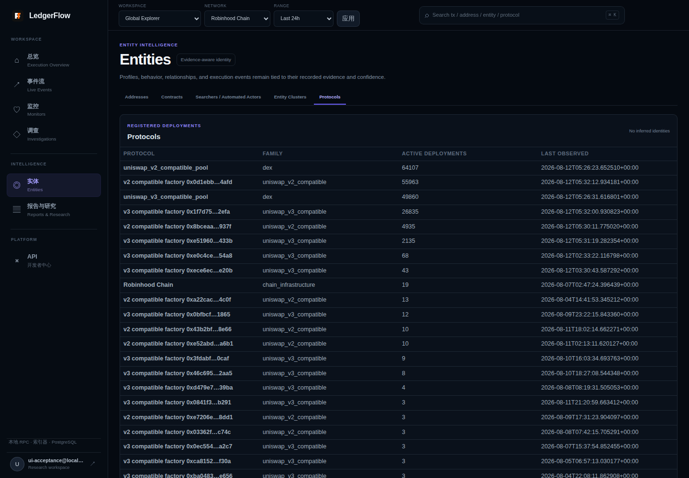
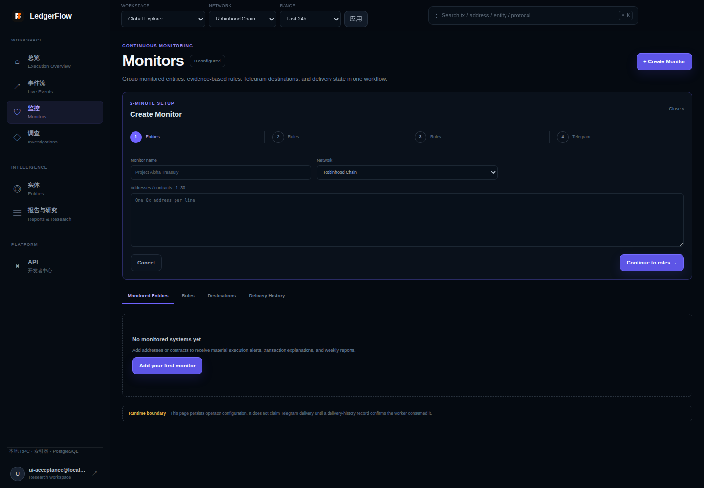

# LedgerFlow Execution Intelligence UI v0.1 — Results

Acceptance date: 2026-08-12  
Branch: `codex/chainactors-intelligence-v2`  
Runtime verified at: `http://127.0.0.1:3001`

This report uses `PASS`, `PARTIAL`, `FAIL`, and `NOT IMPLEMENTED` literally.
An item is `PASS` only when it was implemented and verified. Production event
data remains fail-closed: a detector candidate is never presented as verified
economic fact.

## 1. Gap Analysis

**PASS** — The audit is recorded in
`docs/product/execution-intelligence-ui-gap-analysis.md`. It covers the Axum SSR
architecture, route/API maps, reusable components, missing fields, navigation
mapping, implementation files, and explicitly unchanged modules.

## 2. Architecture and data path

The UI is server-rendered Rust, so the requested frontend types are Rust
enums/structs rather than a parallel TypeScript SPA. Existing APIs were not
changed.

### Modified files for this UI delivery

- `src/web/mod.rs` — routes, handlers, data loaders, SSR components, styles,
  redirects, actions, and UI tests.
- `src/web/execution_intelligence.rs` — typed Workspace/ExecutionEvent model and
  fail-closed adapters.
- `migrations/0033_execution_intelligence_workspace.up.sql`
- `migrations/0033_execution_intelligence_workspace.down.sql`
- `Dockerfile` — packages the compiled public Demo artifacts.
- `README.md` — product IA, ports, startup, data truth, and runtime boundaries.
- `docs/product/execution-intelligence-ui-gap-analysis.md`
- `docs/product/execution-intelligence-ui-results.md`
- `docs/product/screenshots/execution-overview.png`
- `docs/product/screenshots/execution-event.png`
- `docs/product/screenshots/entities.png`
- `docs/product/screenshots/monitors.png`

## 3. New route map

| Route | Surface | Result |
|---|---|---|
| `/app/overview` | Execution Overview | **PASS** |
| `/app/events` | Live Events and Review Queue | **PASS** |
| `/app/events/{event_id}` | Execution Event detail | **PASS** |
| `/app/events/{event_id}/evidence.json` | Structured event export | **PASS** |
| `/app/monitors` | Monitors and four-step setup | **PASS** |
| `/app/investigations` | Investigation list/create | **PASS** |
| `/app/investigations/{id}` | Investigation detail/update | **PASS** |
| `/app/entities` | Unified entity tabs and contextual relationships | **PASS** |
| `/app/reports` | Reports & Research | **PASS** |
| `/app/api` | API / developer centre | **PASS** |

Public, customer-safe Demo artifacts are available at:

- `/demo/base-public/weekly-report`
- `/demo/base-public/weekly-report.md`
- `/demo/base-public/events.json`
- `/public/evidence/events.json` — live, schema-validated public Evidence Pack feed

## Continuous Evidence Explorer publication

**PASS** — Evidence Explorer now reads a 15-second cached live feed. Only Pilot
projects with `project.public_publish: true` are eligible; the flag defaults to
false. The public Base Demo is continuous, existing customer projects remain
private, detector-only events retain Detected / Unverified status, and the
embedded 39-event corpus is used only as an explicitly labelled availability
fallback.

## 4. Navigation structure

The sidebar has exactly seven task-oriented destinations:

1. 总览 / Execution Overview
2. 事件流 / Live Events
3. 监控 / Monitors
4. 调查 / Investigations
5. 实体 / Entities
6. 报告与研究 / Reports & Research
7. API

`Graph` is no longer a first-level destination. Relationships are shown within
Entity and Investigation context.

## 5. Old-to-new mapping

| Old surface | New surface | Result |
|---|---|---|
| Today Intelligence | Execution Overview | **PASS** — redirect retained |
| Actors | Entities / Addresses | **PASS** |
| Teams | Entities / Entity Clusters | **PASS** — no real-world team claim |
| Bots | Entities / Searchers / Automated Actors | **PASS** |
| Candidates | Live Events / Review Queue | **PASS** |
| Cases | Investigations | **PASS** |
| Watchlist + Alerts | Monitors | **PASS** |
| Graph | Entity Relationships | **PASS** |
| Pro Research | Reports & Research | **PASS** |
| API | API | **PASS** |

Deep cluster analysis remains reachable at `/app/clusters/{id}`. The retained
legacy implementation is not exposed as a competing top-level navigation.

## 6. Typed data adapter

**PASS** — `src/web/execution_intelligence.rs` defines:

- `ExecutionEventStatus`: Detected, Verified, Investigating, Resolved, Dismissed.
- Supported event type enum, including the requested first-stage vocabulary.
- Severity, confidence, economic-impact, participant, evidence, timeline, and
  Workspace models.
- Explicit adapters for pilot Evidence Packs and existing arbitrage candidates.

The adapter is fail-closed:

- `candidate` and `analyzed_multi_pool_unconfirmed` become
  `Detected · Unverified`.
- Candidate profit/intent/protocol values stay `null`/`Unknown`.
- Profit is exposed only for an explicitly economically verified stored row.
- Pilot events are Verified only from persisted, deterministic Evidence Packs.
- `Unknown` is serialized as `null`; it is never coerced to zero.

## 7. Completed pages

### Execution Overview

**PASS**

- First screen shows attention count, range, monitored count, update time,
  network, and data state.
- Needs Attention is limited to five events and prioritizes verified/severity.
- Real production candidates are visibly `Detected · Unverified`.
- Cards answer conclusion, affected entities, economic impact, confidence, time,
  and next action.
- Inventory counts for Labels, Tokens, and Analyses are removed from the primary
  dashboard.
- Action metrics are Material Events, Economic Value, Failed Execution Cost,
  and New / Changed Actors. Unavailable economic values show `Unknown`.
- Monitored Systems, Live Events, Actors Requiring Review, Recent
  Investigations, and System Status are present with honest empty states.

### Execution Event

**PASS**

- Conclusion, severity/status/confidence/network/time/hash.
- Economic Impact with eight evidence-dependent fields.
- Execution Timeline containing only recorded steps.
- Participants linking to Entities.
- Evidence in a secondary collapsed section.
- Actions for Investigation, Entity tracking, rule setup, JSON export,
  transaction explanation, and copying the page link.

**PARTIAL** — Public Evidence Pack sharing for authenticated event records is
shown disabled. Authenticated JSON export and the pre-existing public
transaction-explanation share flow work; an auth-safe generic public event
share model does not exist.

### Live Events / Review Queue

**PASS**

- Compact table implemented with time, status, severity, event/conclusion,
  impact, actors, confidence, and open action.
- Status, severity, event type, network, protocol, entity, confidence, and range
  filters are implemented.
- Review Queue contains detected, low-confidence, missing-evidence, and unknown
  interactions.

**NOT IMPLEMENTED** — A second card/list toggle was not added; the specification
requires at least one complete view, and the table is the complete view.

### Entities

**PASS**

- Addresses, Contracts, Searchers / Automated Actors, Entity Clusters, and
  Protocols are unified as tabs.
- Address detail includes Profile, Behavior, Relationships, and Recent Events.
- Relationships query only persisted asset-flow edges and is scoped to the
  selected entity.
- Entity Clusters explicitly avoid asserting real-world team identity.
- Protocol identities come from active registered deployments, never shape
  guessing.

### Monitors

**PASS**

- Monitored Entities, Rules, Destinations, and Delivery History are tabs in one
  workflow.
- The four-step setup is Entities → Roles → Rules → Telegram.
- Server validation enforces one to 30 valid EVM addresses, deduplication,
  supported event types, severity, optional non-negative threshold, and an
  explicit destination reference.
- Monitor, entity, rule, and Telegram destination records are committed in one
  PostgreSQL transaction.
- Legacy watchlist/cluster alerts remain visible as compatibility data.

**PARTIAL** — The UI persists complete operator configuration, but the existing
Telegram worker has not been changed to consume the new generic
`user_monitor_*` tables. The page explicitly states this runtime boundary and
does not claim delivery without a delivery-history record.

### Investigations

**PASS**

- Event-to-Investigation creation persists a snapshot of source evidence.
- Open, In Review, Resolved, and Archived states are supported.
- Working conclusion, open questions, notes, related events/entities, evidence,
  and timestamps are stored and rendered.
- Updates are user-scoped in SQL.

### Reports & Research

**PASS** — Existing user-owned report snapshots, generated exports, and the
public Base Demo report are collected under one secondary surface.

**PARTIAL** — No standalone Same-Flashblock Backruns research artifact exists
in the repository, so it is labeled planned instead of being fabricated.

## 8. Workspace / Network / Range / Search

**PASS** — Global Explorer and named cluster-backed workspaces have a typed
abstraction and URL state. Network, 24h/7d/30d range, and tx/address/entity/
protocol search are present in the global header.

**PARTIAL** — `All networks` is visibly disabled because the backend has no
cross-chain aggregate contract; Custom range is not implemented. Named
workspaces reuse owned Entity Clusters rather than adding a multi-tenant model.

## 9. Persistence and migration

**PASS** — Migration 33 was executed by the production Web startup and recorded
as `execution intelligence workspace`. It adds:

- `user_monitors`
- `user_monitor_entities`
- `user_monitor_rules`
- `user_monitor_destinations`
- `user_monitor_delivery_history`
- `execution_investigations`

The reverse migration is provided. No schema was modified outside migrations.

## 10. Automated test and build results

| Check | Result | Evidence |
|---|---|---|
| Format | **PASS** | `cargo fmt --check` exit 0 |
| Type/build check | **PASS** | `cargo check --bin web` exit 0 |
| Lint | **PASS** | `cargo clippy --all-targets --all-features` exit 0 |
| All automated tests | **PASS** | `cargo test --all-targets`: 132 passed, 0 failed |
| Production build | **PASS** | `cargo build --release --bin web` exit 0 |
| Container production build | **PASS** | Compose Web image built with `--release --locked --bins` |
| Migration | **PASS** | `_sqlx_migrations` latest version 33 |
| Authenticated runtime smoke | **PASS** | Core pages returned HTTP 200 |
| Legacy route smoke | **PASS** | `/app/today`, `/app/arbitrage`, `/app/cluster-graph` returned scoped 303 redirects |
| Event → Investigation | **PASS** | POST returned 303 and persisted/listed one record |
| Four-step Monitor flow | **PASS** | All steps rendered; POST returned 303 and persisted monitor/rule/destination |

The current repository has no JS component runner, Playwright suite, or Cypress
suite. Rust render/route/adapter tests plus authenticated browser/HTTP smoke
tests were used without introducing a second frontend toolchain.

Lint reports warnings in retained legacy compatibility renderers and older
unrelated modules; there are no lint errors.

## 11. Runtime performance

Measured locally against real production data on the final Web service:

| Surface | HTTP | Server response |
|---|---:|---:|
| `/health` | 200 | about 1–2 ms |
| Execution Overview | 200 | about 50–70 ms |
| Live Events | 200 | about 40–70 ms |
| Execution Event | 200 | about 45–50 ms |
| Address Entity detail | 200 | about 67–89 ms |
| Entities / Protocols | 200 | about 91 ms |
| Monitors | 200 | about 6–13 ms |

Address Entity detail previously measured 2.8–4.3 seconds because it waited on
Indexer transaction references/global progress that the page did not render.
The final path measures 67–89 ms. The full legacy address analysis remains
available for deeper coverage diagnostics. Address summary is bounded to a
one-second UI budget, while relationships are queried only for the selected
address.

## 12. Screenshots

The screenshots use an isolated acceptance account and real database-backed
event/protocol data. They contain no customer data or private RPC credentials.

### Execution Overview

### Execution Event

### Entities

### Monitors

## 13. Hard acceptance checklist

### Information architecture

- **PASS** — Top-level business navigation has seven entries.
- **PASS** — Actors / Teams / Bots are merged into Entities.
- **PASS** — Watchlist / Alerts are merged into Monitors.
- **PASS** — Graph is no longer top-level.
- **PASS** — Candidates are in Live Events / Review Queue.
- **PASS** — Cases are Investigations.
- **PASS** — Research is not an Overview primary CTA.

### Overview

- **PASS** — First screen shows items needing attention.
- **PASS** — At least one real database-backed event card is shown.
- **PASS** — Event cards include conclusion, impact, status, confidence, and actions.
- **PASS** — Unconfirmed events are explicitly unverified.
- **PASS** — Labels/Tokens/Analyses counts are out of the primary Overview.
- **PARTIAL** — Workspace/Network/24h–30d range work; All/Custom are unavailable.

### Event detail

- **PASS** — Conclusion.
- **PASS** — Economic Impact.
- **PASS** — Execution Timeline.
- **PASS** — Participants.
- **PASS** — Evidence.
- **PASS** — Actions.
- **PASS** — Unknown is not rendered as zero.
- **PASS** — Conclusion is visually primary; raw evidence is secondary/collapsed.

### Workflow

- **PASS** — Event creates Investigation.
- **PASS** — Event opens Entity tracking flow.
- **PASS** — Event opens a preselected Monitor rule flow.
- **PASS** — First Monitor can be configured in four short steps.
- **PASS** — Old routes have contextual redirects.

### Engineering quality

- **PASS** — Rust type checking passes (the repository is not TypeScript).
- **PASS** — Lint command passes.
- **PASS** — Production and container builds pass.
- **PASS** — Automated tests pass.
- **PASS** — Existing production API contracts are unchanged.
- **PASS** — No production mocks or fabricated economic values were introduced.
- **PASS** — README records the new IA and startup route/ports.

## 14. Known limitations

No required top-level page is wholly unimplemented. The following capability
boundaries remain partial or unavailable and are intentionally visible in the
UI rather than simulated.

1. Generic Monitor configuration is not yet consumed by the Telegram delivery
   worker; delivery history remains authoritative and empty until integration.
2. Event lifecycle mutation is not backed by a canonical event-state service;
   detected/verified are source-derived, while investigation state is persisted
   separately.
3. Public Evidence Pack sharing for authenticated events is unavailable; JSON
   export and existing transaction share links are available.
4. All-network aggregation and custom date ranges are unavailable.
5. Workspaces are an intentionally lightweight Global Explorer / owned cluster
   abstraction, not a multi-tenant permission system.
6. Some compatibility renderers remain in `src/web/mod.rs` and generate
   dead-code warnings after their routes were redirected.

## 15. Next phase recommendations

1. Connect `user_monitor_*` configuration to the existing Telegram alert
   worker with delivery, retry, deduplication, and dead-letter records.
2. Add a canonical persisted event-state transition service, including dismiss
   and resolve audit history.
3. Add auth-safe public Evidence Pack share tokens with expiration/revocation.
4. Add bounded All-network aggregation and validated Custom ranges.
5. Split the large SSR module into route, adapter, query, component, and style
   modules without changing its rendering framework.
