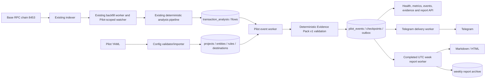

# Phase 1 architecture

The config importer bridges each enabled continuous Pilot to an existing address-cluster tracking row with auto-discovery disabled, so the customer-provided 10–30 address boundary stays exact. The existing indexer/backfill path performs range splitting, deduplication, checkpointing and analysis; the Pilot event worker then reads Base facts from the analysis tables. The LLM boundary is after deterministic facts and is optional language rendering only. It does not select protocols, identities, amounts, status, profit, purpose, or flows. Phase 1 workers do not participate in Searcher execution.
