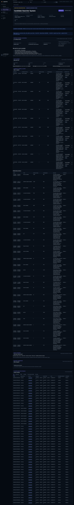

# LedgerFlow Searcher Cluster Intelligence v1 — Results

Date: 2026-08-21

Status vocabulary in this report is literal: `PASS`, `PARTIAL`, `FAIL`, or
`NOT IMPLEMENTED`. Candidate relationships are not ownership claims.

## 1. Current and new data flow

Previous behavior:

```text
Observed address -> seed-only transactions/transfers -> seed profile
```

Implemented behavior:

```text
Observation seed
  -> Base/Robinhood source attestation (fail closed)
  -> deterministic seed-role rules
  -> bounded relationship expansion
  -> evidence-scored candidate execution cluster
  -> worker/executor transaction reconstruction
  -> deterministic economic verification
  -> 24h / 7d / 30d windows
  -> baseline/change signals
  -> bounded incremental refresh
```

On Base, the observation worker now treats `24h / 7d / 30d` only as reporting
windows. Initial discovery can use a configured Blockscout v2 address-history
adapter with resumable keyset cursors to page normal transactions and token
transfers back to the address's earliest activity. Returned hashes are discovery
hints only; RPC, receipt, logs, traces, and deterministic accounting remain the
fact sources.

The seed is an entry point. Pool, router, and protocol relationships remain
infrastructure relationships and cannot become control/economic cluster members.

## 2. Base and Robinhood source audit

- **PASS** — Base API, RPC, indexer, PostgreSQL activity, and response all attest
  `chain_id=8453`.
- **PASS** — Robinhood API, RPC, indexer, and response attest `chain_id=4663`.
- **PASS** — Base and Robinhood use separate API, PostgreSQL, and indexer data
  planes.
- **PASS** — A Base-plane request for Robinhood returns HTTP `503`; it does not
  return zeros or Base rows under a Robinhood label.
- **PASS** — Responses expose chain, source kind, live indexed range, head, lag,
  update time, and history mode without exposing RPC URLs or hostnames.
- **PASS** — Both live indexers were no more than three blocks behind their
  respective heads during the final runtime audit (Base: two; Robinhood: three).
- **PARTIAL** — Neither data plane is a globally complete historical index. Base
  now supports complete per-address discovery through a configurable external
  adapter without replaying every chain block. Robinhood has no equivalent
  provider configured and retains partial local history. Coverage is disclosed
  rather than inferred.

Detailed evidence: [base-runtime-data-source-audit.md](base-runtime-data-source-audit.md).

## 3. Migration and contract

### Migration

- **PASS** — `0050_searcher_cluster_intelligence_v1` was applied through the
  existing migration runner to both runtime PostgreSQL databases.
- **PASS** — It adds candidate clusters, members, relationships, executions,
  window summaries, change signals, and member overrides without removing the
  existing Entity, Monitor, Investigation, or Observed Object tables.
- **PASS** — Down migration is present.

### Intelligence Contract v1

- **PASS** — `schemas/searcher-cluster-intelligence-v1.schema.json` validates the
  source-attested snapshot shape.
- **PASS** — Asset metadata carries token address, symbol, decimals, and metadata
  status. Amounts remain exact raw integers.
- **PASS** — Execution timeline supports bounded pagination using
  `execution_limit` and `execution_offset`; the full evidence remains in the
  database.
- **PASS** — Evidence previews disclose their original counts and are bounded in
  the response. The default live response for the external seed decreased from
  about 989 KB to about 141 KB.

## 4. Seed role classification

Rules use deterministic activity only:

- funding/treasury candidate: fan-out funding or fan-in collection with little
  direct execution;
- worker candidate: top-level execution frequency, repeated executor calls, and
  funding evidence;
- executor candidate: contract code plus repeated worker calls and multi-contract
  execution evidence;
- settlement recipient candidate: execution-correlated inflows with little or no
  direct execution.

Every result includes evidence state, confidence, transaction/transfer examples,
facts, method version, and limitations.

### External Base seed result

Seed: `0x0629da86af5a4ae1ba5e1589b13702558d0fb056`

- **PASS** — Classified as `settlement_recipient_candidate`, confidence `0.99`.
- **PASS** — Evidence at the final sample: 12,437 observed inflow transfers from
  five sources, zero top-level sent transactions, zero direct execution actions,
  and zero observed outflow transfers.
- **PASS** — UI wording says candidate/observed and explicitly says settlement
  inflow is not necessarily profit.

This is strong evidence for a collector/settlement role, not proof of ownership
or common control.

## 5. Relationship discovery and cluster scoring

The bounded expansion combines exact transfer edges, repeated co-execution,
top-level call targets, contract-code status, trace/log activity, pool/registry
evidence, first/last seen time, and supporting transaction hashes. Similar gas,
route, or cadence is not sufficient for membership.

Cluster membership scores use evidence type, interaction count, contract/EOA
role compatibility, and infrastructure exclusions. Candidate members can be
included, excluded, re-labelled, or retained as candidates through migration-
backed overrides.

### External seed relationship result

| Candidate role | Members | Mean confidence | Included in economic scope |
|---|---:|---:|---:|
| Seed | 1 | 1.000 | 1 |
| Worker candidate | 6 | 0.962 | 6 |
| Executor candidate | 5 | 0.814 | 1 |

The dominant executor candidate had confidence `0.98` and more than 12,000
seed-correlated interactions. The six worker candidates ranged from `0.92` to
`0.98`. Four low-frequency executor candidates remain outside economic scope.

- **PASS** — Six worker candidates and five executor candidates were returned
  with individual reasons, counts, evidence examples, first/last seen, and
  confidence.
- **PASS** — Pool, router, and protocol addresses appear as relationships, not
  candidate cluster members.
- **PASS** — Pool/router false economic membership for this real case is zero.
- **PASS** — Manual correction actions are persisted and re-materialize the
  candidate scope; no ownership language is introduced.

## 6. Cluster execution reconstruction

- **PASS** — The timeline is reconstructed from candidate worker/executor
  transactions rather than seed-only top-level transactions.
- **PASS** — Funding, execution, settlement, approvals, deployment, failures,
  DEX swaps, multi-pool swaps, closed cycles, liquidations, and unknown
  interactions have separate typed states.
- **PASS** — Each execution stores worker, executor, receipt status, exact gas,
  protocols, pools, route, input/output assets, settlement transfers, candidate
  recipient, economic state, exclusions, digest, and evidence references.
- **PASS** — The API supports pagination over all reconstructed records.
- **PARTIAL** — Deep trace/protocol reconstruction is intentionally asynchronous.
  Basic deterministic receipt/gas rows are published first; the response marks
  pending deep reconstruction and verification explicitly.

## 7. Cluster economic accounting

The accounting planes are separate:

1. verified execution surplus by asset;
2. exact verified gas;
3. observed settlement inflow (not necessarily profit);
4. capital sent/returned (funding, never profit);
5. failed execution gas;
6. coverage and explicit exclusions.

- **PASS** — Funding and settlement execution types cannot be verified as
  execution profit.
- **PASS** — Failed transactions contribute exact failed gas and no profit.
- **PASS** — Multi-asset verified surplus is preserved as an asset vector; assets
  are never summed across denominations.
- **PASS** — A scalar net is shown only when gas and verified surplus are in a
  deterministically comparable native/wrapped-native asset.
- **PASS** — Every verified result links to transaction, receipt, trace/log, and
  archive-balance reconciliation evidence.

### External seed, materialized 24h window sampled at 2026-08-21 01:12 UTC

| Measure | Result |
|---|---:|
| Candidate executions | 2,967 |
| Successful | 2,967 |
| Failed | 0 |
| Exact cluster gas | 0.017975157498930713 ETH |
| Economically verified | 5 |
| Verified gross surplus | 0.000029328860190828 WETH + 0.00000130 cbBTC |
| Verified gas for those executions | 0.000029908709117674 ETH |
| Verified comparable-asset net | +0.000010525049510893 WETH |
| Complete cross-asset scalar total | Not available |
| Economic coverage | 5 / 2,967 (0.1685%) |

The WETH execution has a comparable-asset net. The cbBTC surplus and its ETH gas
are deliberately not subtracted into a made-up cross-asset total. The page
explains why complete PnL is unavailable. At the same snapshot, 2,573 rows
awaited deep reconstruction, 196 awaited deterministic verification, 118 lacked
trace evidence, 60 did not have two deterministic swap emitters, ten failed
receipt/archive reconciliation, four had same-block scoped balance conflicts,
and one failed native trace/archive reconciliation.

Observed settlement inflows are displayed as per-token vectors and remain
separate from verified profit. They include WETH, USDC, cbBTC, and other tokens;
no cross-asset total is asserted.

## 8. 24h / 7d / 30d cluster summary and changes

| Window | Executions | Success | Failure | Exact gas | Verified | Coverage |
|---|---:|---:|---:|---:|---:|---:|
| 24h | 2,967 | 2,967 | 0 | 0.017975157498930713 ETH | 5 | 0.1685% |
| 7d | 8,720 | 8,720 | 0 | 0.086888886859238347 ETH | 5 | 0.0573% |
| 30d requested | 8,720 | 8,720 | 0 | 0.086888886859238347 ETH | 5 | 0.0573% |

- **PASS** — These windows do not depend on Material Events.
- **PASS** — Top workers, executors, protocols, strategy distribution, settlement
  vectors, gas, last active, and coverage are materialized.
- **PARTIAL** — The available external-seed history currently covers about 31
  calendar days at the address layer, but candidate executions are concentrated
  in the recent available period. The 30d label is a requested window, not a
  claim of globally complete Base history.
- **PARTIAL** — No previous-7d execution baseline exists in the currently
  discovered external-seed data, so the UI says the baseline is still being
  built instead of claiming zero change.

## 9. Continuous refresh and performance

- **PASS** — Initial and incremental work has checkpoint, retry, deduplication,
  idempotent upserts, partial snapshots, and exact progress states.
- **PASS** — A Cluster job that starts before deterministic seed activity is
  ready is deferred instead of failed. It resumes automatically after the
  Observed Object becomes ready; no user Retry action is required.
- **PASS** — Initial readiness analyzes the complete 24h basic activity first,
  then a bounded deep sample. Older 30d depth continues asynchronously.
- **PASS** — Incremental work processes one bounded deep/economic batch and then
  republishes windows; it no longer waits to deep-analyze thousands of rows.
- **PASS** — A cluster becomes stale only after its Observed Object has actually
  processed a newer block. Chain-head movement alone no longer causes continuous
  full cluster rescans.
- **PASS** — API default response is 20 timeline rows and about 141 KB for this
  evidence-heavy seed; larger pages are explicit and paginated.
- **PARTIAL** — The first implementation run for this pre-existing high-volume
  seed took about 26 minutes because it used the superseded unbounded deep path.
  The bounded path was verified on incremental refresh (ready in seconds), but a
  clean end-to-end high-volume seed benchmark is still required before claiming
  all `<=1/5/10 minute` targets.
- **NOT IMPLEMENTED** — A seven-day production soak result is not available in
  this implementation session.

## 10. Ground-truth regression

A private ignored configuration is generated from production Searcher
configuration without printing or committing addresses/keys. The harness reports
only recall/error metrics. The private Robinhood case contains one known worker,
nine configured executors, and one configured settlement recipient.

- **PASS** — Private fixture generation, secret exclusion, and metric harness are
  implemented.
- **PASS** — Static/runtime invariants show router/pool economic membership `0`
  and funding-as-profit errors `0` for the external Base case.
- **NOT IMPLEMENTED** — Base self-architecture recall cannot be measured because
  no Base self-Searcher ground-truth configuration exists on this host.
- **FAIL** — Robinhood worker/executor recall thresholds are not met. The final
  regression run found no deterministic activity for the configured self seed in
  the available bounded history, materialized only the seed, and measured worker
  recall `0.0%`, executor recall `0.0%`, and settlement recall `100.0%`. Router /
  pool false membership and funding-as-profit errors remained zero. Hard-coding
  configured relationships into the result was intentionally rejected.
- **NOT IMPLEMENTED** — Therefore known-worker recall `>=90%` and known-executor
  recall `>=95%` remain unaccepted.

## 11. UI result

The Observed Object page now renders, in order:

1. candidate searcher system and source freshness;
2. verified economics, gas, settlement inflows, coverage, and limitations;
3. last-24h execution summary;
4. candidate workers/executors and manual correction controls;
5. typed relationship evidence;
6. funding -> worker -> executor -> DEX -> settlement flow;
7. baseline changes or an explicit baseline-building state;
8. paginated cluster execution timeline.

The Workspace Overview consumes the same cluster snapshot and shows per-object
execution, candidate-member, verified coverage, main behavior, and last-active
facts instead of seed-only zeros.

- **PASS** — No website, public navigation, or product naming was changed.
- **PASS** — The page no longer reduces this seed to `asset transfer`, a generic
  relationship count, and `Unknown PnL`.
- **PASS** — Source unavailability fails closed.

Screenshot:



## 12. Tests and build

- **PASS** — `cargo fmt --all -- --check`.
- **PASS** — `cargo check --all-targets`.
- **PASS** — Searcher-cluster service unit tests, including source semantics,
  infrastructure exclusion, exact gas, evidence bounding, and multi-asset
  surplus behavior.
- **PASS** — Migration/JSON Schema integration tests: 2 passed.
- **PASS** — Web evidence-first and decimal-format tests.
- **PASS** — `cargo test --all-targets`; the complete repository test suite
  passed, including 141 library tests and all integration/binary targets.
- **PASS** — Release Docker image build.
- **PASS** — Base and Robinhood API/Web/Observation/Cluster services started and
  reported ready; existing indexers stayed running.
- **PASS** — Existing production Searcher services were neither modified nor
  restarted.

## 13. Modified files

Core implementation:

- `migrations/0050_searcher_cluster_intelligence_v1.up.sql`
- `migrations/0050_searcher_cluster_intelligence_v1.down.sql`
- `schemas/searcher-cluster-intelligence-v1.schema.json`
- `src/services/searcher_cluster_intelligence.rs`
- `src/services/indexer_client.rs`
- `src/services/mod.rs`
- `src/bin/ledgerflow_searcher_cluster_worker.rs`
- `src/api/mod.rs`
- `src/main.rs`
- `src/web/mod.rs`
- `Dockerfile`
- `docker-compose.yml`
- `.env.example`

Verification and documentation:

- `tests/searcher_cluster_intelligence.rs`
- `scripts/generate_private_searcher_ground_truth.sh`
- `scripts/verify_searcher_cluster_intelligence.mjs`
- `.gitignore`
- `docs/product/base-runtime-data-source-audit.md`
- `docs/product/searcher-cluster-intelligence-gap-analysis.md`
- `docs/product/searcher-cluster-intelligence-results.md`

## 14. Known limitations and uncompleted items

- **PARTIAL** — Full economic analysis is optimized for execution-oriented
  entities. Generic wallet PnL is outside scope.
- **PARTIAL** — Only deterministic, scope-complete executions can become
  verified. Current economic coverage is low and is reported as such.
- **PARTIAL** — Cluster discovery presently begins from transactions evidenced by
  the seed. A worker that permanently stops settling/funding through the seed may
  require a later member-address incremental scheduler.
- **PARTIAL** — Total net across unrelated assets is intentionally unavailable;
  historical prices are not used to fabricate a cross-asset total.
- **NOT IMPLEMENTED** — Base internal ground truth and both recall acceptance
  thresholds need observable onchain executions/configuration before evaluation.
- **NOT IMPLEMENTED** — Clean cold-start performance against a second comparably
  high-volume seed and a seven-day soak result remain outstanding.

Deferred benchmark details are recorded in
[`searcher-cluster-intelligence-todo.md`](searcher-cluster-intelligence-todo.md).

## 15. Hard acceptance checklist

### Data source

- **PASS** — Base queries real Base data.
- **PASS** — Robinhood queries real Robinhood data.
- **PASS** — Mismatch fails closed.
- **PASS** — Range and freshness are displayed.

### Cluster

- **PASS** — Seed role classification.
- **PASS** — Typed candidate relationships with evidence.
- **PASS** — Candidate execution cluster.
- **PASS** — Candidate members have confidence/evidence.
- **PASS** — Pool/router economic membership is zero.
- **PASS** — Manual correction.

### Economics

- **PASS** — Funding is not profit.
- **PASS** — Settlement inflow is separate.
- **PASS** — Worker gas and failed gas are accounted separately.
- **PASS** — Verified result, coverage, and exclusions are visible.
- **PASS** — Unavailable totals have concrete reasons.

### Product

- **PASS** — Current collector resolves to a Candidate Searcher System.
- **PASS** — First section answers economic status without inventing a total.
- **PASS** — 24h execution activity is present.
- **PASS** — Worker/executor candidates and money path are present.
- **PARTIAL** — Change comparison awaits a usable previous-window baseline.
- **PASS** — Results do not depend on Material Events.

### Regression

- **NOT IMPLEMENTED** — Known worker recall `>=90%`.
- **NOT IMPLEMENTED** — Known executor recall `>=95%`.
- **PASS** — Router/pool false membership `=0` in the real external case.
- **PASS** — Funding-as-profit errors `=0`.
- **PASS** — Verified economic results are evidence-linked.

Overall result: **PARTIAL**. The external acceptance address now answers role,
candidate workers/executors, 24h activity, exact gas, verified economic coverage,
settlement paths, and baseline limitations. Internal discovery-recall thresholds
remain deliberately unaccepted until observable Base/Robinhood ground truth is
available.

## 16. Follow-up: unbounded per-address discovery

- **PASS** — The 30-day value is no longer the initial discovery boundary when
  the external history adapter is configured. It remains a product summary
  window only.
- **PASS** — The Base adapter uses Blockscout v2 keyset pagination with persisted
  normal-transaction and token-transfer cursors. Provider rate limits defer the
  object without consuming its analysis retry budget.
- **PASS** — Third-party fields are discovery-only. Canonical RPC transaction,
  receipt, logs, traces, and deterministic accounting still gate all economic
  facts.
- **PARTIAL** — The existing collector was re-queued for the new full-address
  pass. Its independently discovered earliest activity block is `22,794,806`;
  the asynchronous v2 cursor was advancing at the final check and full history
  had not yet completed.
- **PARTIAL** — Internal-transaction pagination is disabled by default because
  the public provider did not serve the high-volume query reliably. Internal
  execution flows remain reconstructed from canonical traces of discovered
  transactions.
- **TODO** — High-volume cold-start performance is deliberately deferred and is
  recorded in `searcher-cluster-intelligence-todo.md`.

At the follow-up runtime sample, economic coverage had advanced from the earlier
`0.1685%` point-in-time snapshot to `282 / 4,164` executions (`6.77%`). The
remaining rows consisted primarily of 2,009 pending deep reconstructions, 41
pending economic verifications, 1,249 rows without two deterministic swap-log
emitters, 329 receipt/archive balance mismatches, 124 same-block isolation
conflicts, 118 unavailable traces, ten native reconciliation mismatches, and one
ambiguous surplus scope.
